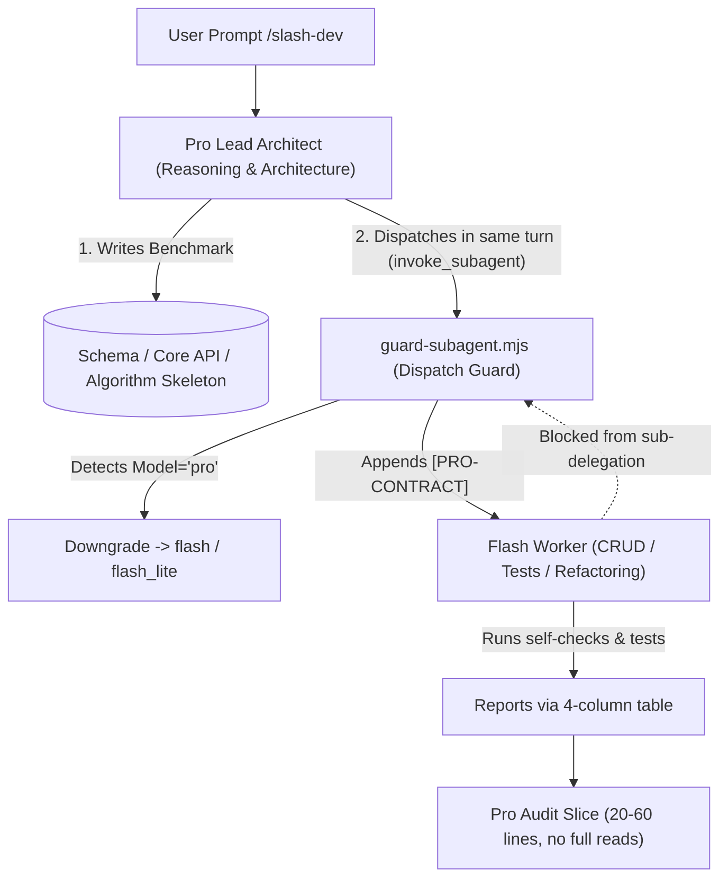

<div align="center">

# Pro-Flash Orchestrator

**High-Efficiency Model Orchestration Engine for Google Antigravity**  
*Pro (Flagship Architect) plans & guides; Flash / Flash-Lite (Lightweight Workers) expand & verify.*

[](https://opensource.org/licenses/MIT)
[](https://github.com/demgkp1/pro-flash-orchestrator)
[](#)
[](#)

[English](README.md) | [简体中文](README.zh-CN.md)

</div>

---

## 📌 Why Pro-Flash Orchestrator?

When working on complex software development with AI agents, using the flagship reasoning model (`Pro`) for every task leads to common pitfalls:
1. **Quota & Budget Exhaustion**: Expensive `Pro` tokens are wasted writing boilerplate CRUD, unit tests, and reading huge logs.
2. **Context Window Flooding**: Agents tend to perform unbounded `cat` or read massive code files directly, causing context bloat and degrading reasoning quality.
3. **Prompt Drift**: Soft guidelines like "please delegate mechanical work" in System Prompts are frequently ignored by models during long coding sessions.

**Pro-Flash Orchestrator** resolves this through **hard physical Hook guards**. Positioned directly inside Antigravity's tool-execution loop, it blocks context-flooding commands, enforces model downgrades on delegations, and guarantees an efficient "Architect + Worker" division of labor.

---

## 🛡️ Core Guard Defenses (v3.3)



| Guard System | Lifecycle Event | Enforcement & Logic |
| :--- | :--- | :--- |
| **Role & Card Injection** | `SessionStart` | Injects persistent rules once at session creation; status cards use `renderInfo` (rendered in UI only, **0 model tokens**). |
| **`pro` Physical Downgrade** | `PreToolUse` (subagent) | Dispatches with `Model` missing / `inherit` / `pro` are automatically rewritten to `flash` or `flash_lite`. Bypassed only with explicit `[FORCE-PRO]`. |
| **Recursion Prevention** | `PreToolUse` (subagent) | Hard blocks sub-agents from spawning further sub-agents (`deny`), eliminating infinite recursion loops. |
| **Neutral Contract Injection** | `PreToolUse` (subagent) | Injects `[PRO-CONTRACT]`: implementation workers must report with a 4-column table and test proof; `research` agents output structured summaries in messages without write attempts. |
| **Smart Large-File Slicing** | `PreToolUse` (read_file) | Files between 300–800 lines are smoothly clamped to 150 lines (zero round-trip cost); >800 line code or >400 line docs are intercepted to force delegation. Dependencies (`.venv`, `target`) are automatically exempt. |
| **Dump Prevention & Redirection** | `PreToolUse` (run_command) | Multi-layer shell unwrapping (PowerShell/cmd/bash/zsh). Blocks unbounded dumps of >400KB files and unbounded `git log`. Safely allows file redirections (`>`, `>>`, `| Set-Content`, `> /dev/null`). |
| **Drift Detection** | `PreInvocation` | Analyzes conversation transcript windows. Injects a transient, single-turn `ephemeralMessage` only when the agent has made 4+ consecutive solo file edits without delegating. |

---

## 🚀 One-Line Installation

Simply clone directly into Antigravity's global plugin directory with a single command—no intermediate folders or setup scripts needed:

### Windows (PowerShell)
```powershell
git clone https://github.com/demgkp1/pro-flash-orchestrator.git "$HOME\.gemini\config\plugins\pro-flash-orchestrator"
```

### macOS / Linux (bash / zsh)
```bash
git clone https://github.com/demgkp1/pro-flash-orchestrator.git ~/.gemini/config/plugins/pro-flash-orchestrator
```

> **Updating**: To update to the latest version in the future, simply run:
> ```bash
> cd ~/.gemini/config/plugins/pro-flash-orchestrator && git pull
> ```

<details>
<summary>🛠️ Developer Mode (Linking from a custom workspace)</summary>

If you want to develop and hack on the plugin from your own repository workspace (e.g. `~/workspace/pro-flash-orchestrator`) and link it to Antigravity:

- **Windows**:
  ```powershell
  cd <your-workspace-dir>
  .\install.ps1
  ```
- **macOS / Linux**:
  ```bash
  cd <your-workspace-dir>
  chmod +x ./install.sh && ./install.sh
  ```
</details>

---

## 🛠️ Usage & Workflow

The plugin includes the `/flash-dev` skill out of the box. You can invoke it in your chat:

```text
/flash-dev Build a microservice for user auth and payment. Design the database schema, DDD boundaries, and the core benchmark service; dispatch Flash in the same turn to write the rest of CRUD, DTO validation, and integration tests.
```

### Standard Sandwich Collaboration:
1. **Pro Benchmarks**: The architect writes the DDL, core interface, algorithm skeleton, or design tokens.
2. **Same-Turn Dispatch**: In the same turn, the architect calls `invoke_subagent` to delegate peripheral modules and test suites to `flash` (Hooks automatically inject contracts).
3. **Audit Slices**: The architect checks `git status --porcelain` and reads 20–60 line slices based on the reported line numbers.

---

## ⚙️ Operational Modes

| Mode | Behavior | Recommended Use |
| :--- | :--- | :--- |
| **`enforce`** (Default) | All physical guards actively block and rewrite. | Standard daily development. |
| **`shadow`** | Logs decisions to `.state/decisions.jsonl` without modifying actions. | Observing behavior on new projects. |
| **`off`** | All hooks bypass completely. | Emergency troubleshooting. |

### Switching Modes
- **Environment Variable** (Terminal Session):
  ```bash
  export PRO_MODE=shadow        # macOS / Linux
  $env:PRO_MODE="shadow"        # Windows PowerShell
  ```
- **Configuration File**: Write `{"mode":"shadow"}` to `.state/mode.json`.

---

## 🔍 Diagnostics & Telemetry

The plugin comes with a comprehensive test suite and telemetry reporter:

```bash
# 1. Run the 52-test automated diagnostic suite
node scripts/doctor.mjs

# 2. Review production decisions from the last 7 days (excludes tests)
node scripts/report.mjs

# 3. Custom telemetry window
node scripts/report.mjs --days 30
```

---

## 📂 Repository Structure

```text
pro-flash-orchestrator/
├── plugin.json                 # Antigravity plugin manifest & metadata
├── hooks.json                  # Lifecycle hook matcher & script routes
├── .gitattributes              # Enforces LF line endings for shell scripts
├── LICENSE                     # MIT License
├── README.md                   # English Documentation
├── README.zh-CN.md             # Chinese Documentation (中文说明)
├── install.ps1                 # Windows Junction installer
├── install.sh                  # macOS/Linux symlink installer
├── rules/
│   └── AGENTS.md               # Persistent role rules & boundary definitions
├── skills/
│   └── flash-dev/
│       └── SKILL.md            # /flash-dev prompt templates and procedures
├── scripts/
│   ├── lib.mjs                 # Shared utility library (parsing, subagent check, normalization)
│   ├── session-start.mjs       # Startup role injection & status card rendering
│   ├── pre-invocation.mjs      # Sliding-window transcript drift detector
│   ├── guard-subagent.mjs      # Sub-agent guard (recursion block, downgrade, neutral contracts)
│   ├── guard-read-file.mjs     # Read guard (smart slicing, dependency path exemptions)
│   ├── guard-command.mjs       # Command guard (multi-layer unwrap, safe redirection, dump blocks)
│   ├── doctor.mjs              # 52-assertion test suite
│   └── report.mjs              # Decision log analytics & review
└── assets/
    └── logo.svg                # Plugin icon
```

---

## 📄 License

This project is licensed under the [MIT License](LICENSE). Contributions, bug reports, and pull requests are welcome!
