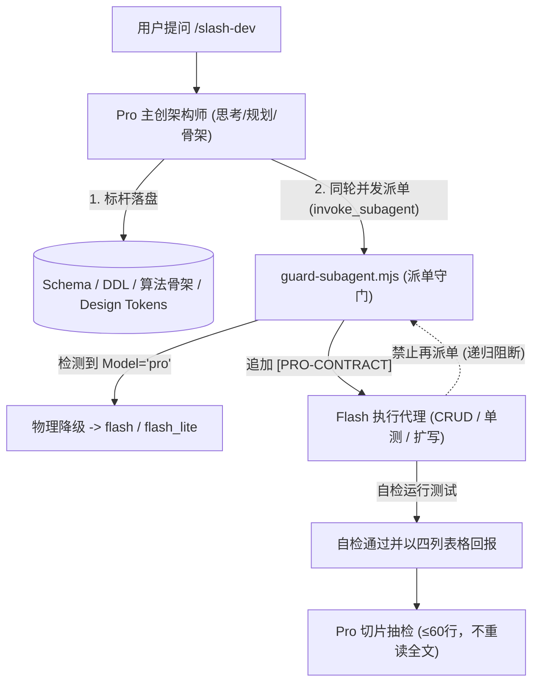

<div align="center">

# Pro-Flash Orchestrator

**面向 Google Antigravity 的高能效大模型协同分流引擎**  
*Pro（高智商主创）把握方向与架构，Flash / Flash-Lite（轻量模型）负责工程扩写与自检*

[](https://opensource.org/licenses/MIT)
[](https://github.com/demgkp1/pro-flash-orchestrator)
[](#)
[](#)

[English](README.md) | [简体中文](README.zh-CN.md)

</div>

---

## 📌 为什么需要 Pro-Flash Orchestrator？

在长程结对编程与复杂系统开发中，直接使用旗舰大模型（Pro）往往面临两大痛点：
1. **配额消耗极快**：昂贵的 Pro 模型频繁陷入机械式 CRUD、测试扩写和海量长日志读取；
2. **上下文被撑爆**：大模型倾向于执行全量 `cat` 或通读超大代码文件，迅速耗尽 Context Window 导致遗忘或失控；
3. **软提醒易失效**：单纯依靠 System Prompt 叮嘱“不要做体力活”极易被模型忽视。

**Pro-Flash Orchestrator** 采用了 **Hook 物理守门机制**，在 Antigravity 底层拦截无界操作，自动化降级外派任务，从系统层面建立起“主创把关 + 工人执行”的硬性分工。

---

## 🛡️ 核心守门防线 (v3.3)



| 守门机制 | 生命周期阶段 | 拦截与防护逻辑 |
| :--- | :--- | :--- |
| **角色注入与状态卡片** | `SessionStart` | 会话启动时注入持久规则；通过 `renderInfo` 展示状态卡片（仅 UI 渲染，模型 0 Token 消耗）。 |
| **`pro` 物理降级** | `PreToolUse` (subagent) | 派单时 `Model` 缺失 / `inherit` / `pro` 自动降级为 `flash`（扩写）或 `flash_lite`（调研）；支持 `[FORCE-PRO]` 豁免。 |
| **递归防套娃** | `PreToolUse` (subagent) | 严禁子代理再次派发子代理，彻底杜绝多层递归死循环。 |
| **中立契约注入** | `PreToolUse` (subagent) | 自动注入 `[PRO-CONTRACT]`：工程代理要求四列表格报告与自测结果；`research` 代理直出结构化要点，不强求写文件。 |
| **大文件智能切片** | `PreToolUse` (read_file) | 代码 >300 行平滑切片至 150 行（零额外轮次）；>800 行代码或 >400 行文档直接拦截逼迫外派；自动豁免 `.venv`、`target` 依赖产物。 |
| **命令防倾倒与重定向放行** | `PreToolUse` (run_command) | 多层 Shell 解包（PowerShell/cmd/bash/zsh）；拦截 >400KB 大文件倾倒与无界 `git log`；放行输出重定向（`>`、`>>`、`| Set-Content`、`> /dev/null`）。 |
| **会话漂移感知** | `PreInvocation` | 基于转录滑动窗口，自上次派单以来连续 4 次直接改文件时注入单轮即抛的 `ephemeralMessage` 提醒分流。 |

---

## 🚀 快速安装

### Windows (PowerShell)
```powershell
# 1. 克隆到本地任意目录（例如 D:\tools 或 ~/tools）
git clone https://github.com/demgkp1/pro-flash-orchestrator.git D:\tools\pro-flash-orchestrator
cd D:\tools\pro-flash-orchestrator

# 2. 运行安装脚本（建立目录联接挂载到 Antigravity，无需管理员权限）
.\install.ps1
```

### macOS / Linux (bash / zsh)
```bash
# 1. 克隆到本地任意目录
git clone https://github.com/demgkp1/pro-flash-orchestrator.git ~/tools/pro-flash-orchestrator
cd ~/tools/pro-flash-orchestrator

# 2. 运行安装脚本（建立符号链接挂载到 Antigravity）
chmod +x ./install.sh && ./install.sh
```

> **说明**：安装脚本仅在 `~/.gemini/config/plugins/` 创建符号链接（Junction / Symlink），不占用多余存储。后续只需在仓库目录内执行 `git pull` 即可无缝升级。

---

## 🛠️ 使用与工作流

本插件内置了 `/flash-dev` 标准工程技能，支持在聊天框中直接触发：

```text
/flash-dev 开发一套后端系统服务（用户认证/订单处理/支付），由你设计数据库Schema、DDD分层与核心标杆Service，同轮并发派发 Flash 扩写其余CRUD、DTO校验与集成测试
```

### 标准三明治协作闭环：
1. **Pro 落盘标杆**：主创编写 Schema、核心 API 契约、算法核心或 Design Tokens；
2. **同轮并发外派**：主创调用 `invoke_subagent` 委派 Flash 扩写外围模块与单元测试（Hook 自动注入汇报契约）；
3. **切片抽检验收**：主创运行 `git status --porcelain`，按汇报的起止行号切片抽检 20–60 行，复跑自测。

---

## ⚙️ 运行模式与调优

| 运行模式 | 行为特性 | 适用阶段 |
| :--- | :--- | :--- |
| **`enforce`**（默认） | 全部物理守门即时生效 | 标准日常开发 |
| **`shadow`** | 仅记录决策日志，不实施修改与拦截 | 首次接入试运行与边界观测 |
| **`off`** | 全部关闭，完全放行 | 紧急临时排障 |

### 切换模式
- **当前终端环境变量**：
  ```bash
  export PRO_MODE=shadow        # macOS / Linux
  $env:PRO_MODE="shadow"        # Windows PowerShell
  ```
- **全局文件配置**：在 `.state/mode.json` 写入 `{"mode":"shadow"}`。

---

## 🔍 健康体检与决策复盘

插件自带完整的自动化测试与可观测性套件：

```bash
# 1. 运行 52 项端到端及单元自检
node scripts/doctor.mjs

# 2. 查看最近 7 天真实生产决策统计（自动排除 doctor 自检数据）
node scripts/report.mjs

# 3. 自定义统计天数
node scripts/report.mjs --days 30
```

---

## 📂 仓库目录结构

```text
pro-flash-orchestrator/
├── plugin.json                 # Antigravity 插件配置与元数据清单
├── hooks.json                  # 生命周期 Hook 匹配与命令路由
├── .gitattributes              # 固化 Shell 脚本 LF 换行符
├── LICENSE                     # MIT 开源许可证
├── README.md                   # 英文技术文档
├── README.zh-CN.md             # 中文技术文档
├── install.ps1                 # Windows 快速挂载脚本
├── install.sh                  # macOS/Linux 快速挂载脚本
├── rules/
│   └── AGENTS.md               # 常驻主创与助手职责规范
├── skills/
│   └── flash-dev/
│       └── SKILL.md            # /flash-dev 派单提示词与工程模板
├── scripts/
│   ├── lib.mjs                 # 核心共享库（Payload 解析、子代理识别、路径归一、日志）
│   ├── session-start.mjs       # 会话启动软引导与状态卡片渲染
│   ├── pre-invocation.mjs      # 转录滑动窗口漂移提醒
│   ├── guard-subagent.mjs      # 派单守门（递归拦截、物理降级、中立契约）
│   ├── guard-read-file.mjs     # 文件读取守门（智能切片、生态豁免）
│   ├── guard-command.mjs       # 命令守门（多层解包、重定向放行、倾倒拦截）
│   ├── doctor.mjs              # 52 项自检测试套件
│   └── report.mjs              # 生产决策聚合与统计复盘
└── assets/
    └── logo.svg                # 插件图标
```

---

## 📄 开源许可证

本项目采用 [MIT 许可证](LICENSE) 开源。欢迎提交 Issue 与 Pull Request。
